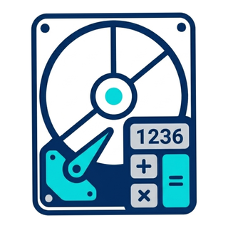

<div align="center">



# 💽 Disk Partition Calculator

**Plan partition sizes in MB, then verify the real layout in Windows Setup.**

[](LICENSE)
[](#requirements)
[](#tech-stack)
[](#tech-stack)
[](#requirements)
[](#tech-stack)

A native Android planning calculator that estimates a partition size in **MB** from a desired
binary **GB** value, or divides one unallocated region into proposed partitions. It cannot inspect
a disk or guarantee the sizes Windows Setup creates.

</div>

---

## Contents

- [Why this app exists](#why-this-app-exists)
- [Features](#features)
- [How the maths works](#how-the-maths-works)
- [Finding unallocated space in Windows Setup](#finding-unallocated-space-in-windows-setup)
- [Tech stack](#tech-stack)
- [Project structure](#project-structure)
- [Build and run](#build-and-run)
- [Privacy](#privacy)
- [Known limitations](#known-limitations)
- [License](#license)

---

## Why this app exists

Windows tools ask for partition sizes in **MB**, while people often aim for a particular Explorer
capacity. This app targets binary units: `1 GB = 1024 MB = 1 GiB` (and each app MB is one MiB).
A 1 TB chip means 1 TiB, not the decimal capacity printed on a drive. Windows views, display
rounding and formatters can differ, so a particular Explorer label cannot be guaranteed.

This is a **planning aid**, not a partition manager. Back up first, select the correct disk, and
verify Setup's actual partition sizes and remaining unallocated space before applying changes.

---

## Features

### 🧮 Calc — one partition

- Enter a desired **total capacity** in binary GB (up to two decimals), not free space
- See the byte target, baseline binary MB and suggested input separately. The actual partition,
  formatted volume capacity and Explorer display may differ
- **+4 MB is added automatically** to the suggested partition size after any measured gap; it is
  an app estimate, not a Microsoft rule or a guaranteed error range. It may be insufficient,
  particularly for FAT32
- Optionally measure a comparable volume, or the existing drive that shows 49.9 GB. For the latter,
  compare its actual capacity with the target and see an estimated extra size (not a new total)
- NTFS/FAT32 selection provides warnings and clears a sample if the filesystem changes; it does
  not format a disk. The Windows OS partition must be NTFS
- Optionally plan a separate reserve for **future** system/recovery partitions. The historic
  Win 10 (566 MB) and Win 11 (826 MB) profiles are legacy examples, not Microsoft sizing rules or
  guaranteed Windows layouts; use Custom (0–100000 MB) for the actual installation
- The future reserve contributes to an **estimated total space budget**, never to the suggested
  partition size or clipboard value

### 🗂️ Split — one unallocated region

- Enter the size of the selected **contiguous unallocated space** in whole MB, using digits only
- Split into 1–8 proposed partitions with integer arithmetic; the last gets the remainder
- Automatically include **+4 MB in each partition**. The buffers are reserved from the selected
  region before splitting, so the sum never exceeds the planned partition budget. Do not add them
  again; formatted capacity is not guaranteed
- Subtract a reserve **only** for system partitions still to be created in this region. Existing
  partitions are already excluded from Setup's displayed unallocated size
- Inspect the selected reserve and edit the shared profile or Custom value directly in Split
- The sum check proves the arithmetic budget only: Setup can create additional partitions or use
  space differently, so each size and the remaining free space must be checked

### ⚙️ Settings and history

- System / Light / Dark themes; shared reserve profile and remembered defaults. Each tab's reserve
  switch is temporary; change the remembered default in Settings
- Last 100 conversions stored locally, with per-row copy and delete; Split entries expand into a
  list of suggested sizes
- History entries from a different calculation version are marked for recalculation because their
  capacity or reserve assumptions may differ. Calibrated results retain and show the measured gap
- On upgrade, the old simulation switch resets to off because the new future-reserve meaning is
  different; the saved profile and Custom value are retained
- A concise Guide tab, plus Privacy Policy, Rate Us, Share App and About in Settings
- Optional Google Play flexible in-app updates; offline or sideloaded builds skip the check

---

## How the maths works

### Calc tab

The target is total capacity in binary GB, independent of Windows' displayed free space. Whole
binary MB is the assumed unit for the input field; check the actual Windows tool and partition.

```text
targetBytes          = ceil(requestedBinaryGb × 1,073,741,824)
baselineMb           = ceil(targetBytes / 1,048,576)
measuredGapBytes     = sampledPartitionBytes − sampledVolumeBytes  # 0 if no sample
appBufferBytes       = 4 × 1,048,576  # app assumption, not a Microsoft rule
suggestedPartitionMb = ceil((targetBytes + measuredGapBytes + appBufferBytes) / 1,048,576)
modelledVolumeBytes  = suggestedPartitionMb × 1,048,576 − measuredGapBytes  # sampled only
# Shown only for an explicitly selected existing NTFS target below the target:
estimatedExtraMb     = ceil((targetBytes − sampledVolumeBytes + appBufferBytes) / 1,048,576)
futureReserveMb      = enabled ? selectedExampleOrCustomMb : 0
estimatedTotalMb     = suggestedPartitionMb + futureReserveMb  # separate budget, not input size
```

For **50 binary GB**, the target is **53,687,091,200 bytes** and the baseline is **51200 MB**.
Without measurements, the unverified +4 MB buffer gives **51204 MB** as a starting suggestion.
For illustration, if a comparable existing volume has a measured gap of **4096 bytes**, the
suggestion becomes **51205 MB**, with a conditional modelled total of **53,692,329,984 bytes**
(about 50.00 GiB to two decimal places). These are examples, not promises: the sample's gap might
not repeat, the partition may not be created at the assumed size, and Explorer may round or report
capacity differently. Microsoft does not prescribe this app's +4 MB buffer.

For a desired 100 GB without a sample, the suggested partition is `102404 MB`. If a *future*
566 MB system reserve is needed, the estimated total space budget is `102970 MB` — **not** the
suggested size to enter for the partition.

### Creating a new 50 GB data volume

1. In Calc enter `50`, select NTFS and calculate. Without a sample, start with **51204 MB**; a
   measured sample may change the suggestion. It is not a guarantee of Explorer's label.
2. Back up, open [Disk Management](https://support.microsoft.com/en-us/windows/experience/storage-filemanagement/disk-management-in-windows),
   identify the correct disk and a sufficiently large **already unallocated** region, and choose
   **New Simple Volume**. Enter the suggested **total** MB; choose a drive letter, NTFS and the
   default allocation unit, then review before finishing. Do not delete another partition for space.
3. Check the new drive's Explorer **Properties → Capacity** including its bytes. If it is below
   the target, use the measurement and existing-drive steps below. This app does not format disks.

### Optional Windows measurement

1. Choose an **already existing basic volume** near the target size, on a comparable disk, with
   the same filesystem, Windows tool/version and similar allocation unit. Do not delete, resize or
   format an existing volume just to take a sample.
2. In PowerShell (as administrator if needed), replace `D` in both read-only commands with that
   volume's drive letter:

   ```powershell
   (Get-Partition -DriveLetter D).Size
   (Get-Volume -DriveLetter D).Size
   ```

3. Enable **Measure a volume / fix 49.9 GB** in Calc. Enter the first result as partition bytes.
   For the second field, prefer the same drive's Explorer **Properties → Capacity** byte value;
   the second PowerShell `Size` is an alternative but can differ. Enter whole digits without
   separators. `SizeRemaining` and Explorer free space must not be used. Dynamic/complex storage
   layouts may not provide a comparable partition–volume pair.
4. After creating and formatting the intended volume through an appropriate Windows tool, verify
   **Properties → Capacity** in Explorer (including its bytes) and the actual partition size.
   Capacity and free space are distinct; quotas may affect what a caller sees. A sample does not
   include separate EFI, MSR or recovery partitions and does not guarantee the same capacity or
   displayed GB string on another volume.

### If an existing 50 GB drive shows 49.9 GB

1. First check **Properties → Capacity**: if 49.9 GB is the *free* space and total capacity is
   already at or above the target in bytes, growth is not needed just to account for used space.
2. Set the target to 50, select the drive's actual filesystem, and use that same drive's two sizes
   as the sample above. Enable **This is the drive I want to correct** and calculate. The app
   displays its measured capacity and shortfall. For NTFS below the target it also estimates an
   **extra** amount; this is an amount to add, not the suggested **new-volume total**. If the
   target is already met, no growth amount is suggested.
3. The extra-size estimate assumes volume capacity increases by the space added; actual results can
   differ. This is not an automatic resize or guarantee. Back up first and review the layout. Microsoft's
   [Extend Volume guide](https://learn.microsoft.com/en-us/windows-server/storage/disk-management/extend-a-basic-volume)
   requires suitable unallocated space immediately after the volume on the same disk. Its built-in
   Extend Volume supports NTFS/ReFS, not FAT32. Do not delete system or recovery partitions to make
   room, and recheck the actual Capacity and available space after any permitted change.

### Split tab

```text
budget       = selectedUnallocatedMb − futureReserveMb
bufferTotal  = 4 × n                  # space for the automatic per-partition additions
baseBudget   = budget − bufferTotal   # divide only what remains
base         = baseBudget / n         # integer division
remainder    = baseBudget % n         # added to the last base share
inputMb      = base + 4               # last partition also receives the remainder
```

Each suggested input includes its 4 MB, so the base shares become smaller when splitting a fixed
region; the summed inputs do **not** exceed the available budget. Adding 4 MB *after* dividing the
whole region would exceed it by `4 × n` MB. The buffer is an estimate, not a prediction of
formatted capacity or Explorer's label. For example, two 50 GB base shares require at least
`2 × (51200 + 4) = 102408 MB` of unallocated space before any future system reserve.

Example: `476923 MB` of unallocated space, divided into four proposed partitions:

| | Partition 1 | Partition 2 | Partition 3 | Partition 4 | Sum |
|---|---|---|---|---|---|
| No future reserve | 119226 + 4 = 119230 | 119226 + 4 = 119230 | 119226 + 4 = 119230 | **119229 + 4 = 119233** | 476923 MB |
| 566 MB future reserve | 119085 + 4 = 119089 | 119085 + 4 = 119089 | 119085 + 4 = 119089 | **119086 + 4 = 119090** | 476357 MB |

Only reserve 566 MB when that space is still needed for system partitions in the selected region.
The sums are arithmetic checks, not proof that the proposed partitions will fit on a real disk.

---

## Finding unallocated space in Windows Setup

1. Back up your files, boot the Windows installer, and identify the correct disk
2. Select the relevant **Unallocated Space**, choose **New**, and read the **Size** in MB before
   pressing Apply. This is the size of that free region, not necessarily the whole disk
3. Enter its whole-MB value in Split using digits only. Existing system partitions are already
   outside that region; do not subtract them again
4. If Setup still needs to create system partitions in that space, estimate their reserve once.
   Check the actual partition layout and remaining free space after each change, and recalculate
   when necessary

Copy actions use the Android device's clipboard; they do not automatically transfer values to
Windows Setup. Windows may create or resize system or recovery partitions. Do not delete or format
any existing partition unless you understand the consequences.

---

## Tech stack

| Item | Value |
|---|---|
| Language | Kotlin 2.0.21 (JVM target 17) |
| UI | Jetpack Compose (BOM 2024.10.01), Material 3 |
| Build | Android Gradle Plugin 8.7.3, Gradle wrapper configured for 9.7.1 |
| SDK levels | `compileSdk` 35 · `targetSdk` 35 · `minSdk` 24 |
| Persistence | DataStore Preferences 1.1.1 + kotlinx.serialization 1.7.3 |
| Updates | Play In-App Updates (app-update-ktx) 2.1.0 · flexible / Play native UI |
| Application ID | `com.diskcalc` — debug builds install as `com.diskcalc.debug` |
| Version | 1.1.4 (versionCode 15) |
| Architecture | Single activity · one `ViewModel` · hand-rolled DI (`AppContainer`) |

Release builds enable **R8 + resource shrinking**; the kotlinx.serialization keep rules for the
history DTOs and a `-dontwarn` rule for the optional Play Core classes live in
`app/proguard-rules.pro`.

---

## Project structure

```text
.
├── app/                             # Android application module
│   ├── build.gradle.kts
│   └── src/main/
│       ├── java/com/diskcalc/       # Kotlin sources (below)
│       ├── res/                     # themes, strings, launcher mipmaps
│       └── AndroidManifest.xml
├── docs/app-icon.png                # app icon shown in this README
├── Icon.png                         # master icon artwork
├── gradle/libs.versions.toml        # version catalog
└── README.md

app/src/main/java/com/diskcalc/
├── MainActivity.kt                  # edge-to-edge single activity, update check
├── DiskCalcApplication.kt           # owns AppContainer
├── domain/                          # pure Kotlin — no Android or Compose imports
│   ├── PartitionConstants.kt        # binary units, app buffer, reserve examples, limits
│   ├── Models.kt                    # enums + result / history data classes
│   ├── PartitionCalculator.kt       # Calc maths + warnings
│   ├── SplitPartitionCalculator.kt  # floor division, remainder on the last slice
│   ├── InputValidator.kt            # user-facing input error strings
│   └── Presets.kt                   # preset chips
├── data/
│   ├── HistoryManager.kt            # HistoryStore + DataStore JSON store
│   ├── HistoryDto.kt                # @Serializable DTOs
│   ├── HistoryMappers.kt            # result → history row
│   ├── IdGenerator.kt               # UUID history ids
│   ├── SettingsRepository.kt        # DataStore preferences
│   └── AppContainer.kt              # tiny hand-rolled DI (no Hilt/Koin)
├── ui/
│   ├── CalculatorScreen.kt          # theme + backdrop + tabs + dialogs
│   ├── CalculatorViewModel.kt       # all state, validation, history writes
│   ├── CalcTab.kt / SplitTab.kt / SettingsTab.kt
│   ├── ResultDialogs.kt / HistorySheet.kt / ResultText.kt
│   ├── InfoPages.kt                 # in-app Guide + Privacy Policy pages
│   ├── components/                  # LiquidGlass, GlassControls, GlassDisplay, GlassTabBar
│   ├── theme/                       # GlassTokens, Theme, LiquidBackdrop
│   └── update/UpdateService.kt      # Play In-App Updates (flexible, Play native UI)
```

---

## Build and run

### Requirements

- **JDK 17** or newer
- **Android SDK Platform 35** + Build Tools (Android Studio Ladybug or newer sets this up)
- A device or emulator running **Android 7.0 (API 24)** or higher

### Debug build

```bash
git clone https://github.com/Sajedur0/Disk-Partition-Calculator-Test.git
cd Disk-Partition-Calculator-Test

# Point Gradle at your SDK (Android Studio does this automatically)
echo "sdk.dir=$HOME/Android/Sdk" > local.properties

./gradlew testDebugUnitTest # calculation, validation, settings and history regression tests
./gradlew assembleDebug     # → app/build/outputs/apk/debug/app-debug.apk
./gradlew installDebug      # install on a connected device
```

### Release build

Release signing is optional and configurable. Create the ignored `signkey` folder with your own
keystore:

```text
signkey/
├── keystore.properties      # storePassword=…  keyAlias=…  keyPassword=…
└── release-key.keystore
```

```bash
./gradlew assembleRelease   # signed when signkey/keystore.properties exists, otherwise unsigned
```

`signkey/` and `*.keystore` are ignored by Git, so keys are never committed.

### Testing flexible updates

The flexible update flow only runs for builds installed **from Google Play** (sideloaded and local
debug builds silently skip the check). Use Play Console **Internal testing** or **internal app
sharing** with a higher `versionCode` to verify both paths: accepting the Play dialog downloads and
installs automatically (the app restarts), while cancelling it leaves the app running normally with
no retry in the same session.

---

## Privacy

- The manifest declares only `INTERNET` (a normal permission, no runtime prompt); Play In-App
  Updates also contributes `ACCESS_NETWORK_STATE` via manifest merging
- **No analytics, no ads, no tracking, no accounts** — the only in-app network-aware component is
  Google Play's flexible in-app update check, which sends no calculation, history or preference data
- The Guide can open Microsoft help pages in your browser when tapped, without calculation data
- Backup is disabled (`allowBackup=false`); settings and history stay on the device (DataStore)
  and history can be cleared any time. The sample inputs and target-drive flag stay in memory;
  their measured gap is saved with the result in history

The full policy is inside the app under **Settings → Privacy Policy**.

---

## Known limitations

1. **4 MB, sampled gaps and system-reserve presets are estimates**, not universal formatter or
   Setup values. Results can vary with the filesystem, cluster size, installer, disk layout,
   quota and display rounding; an exact Explorer string cannot be promised
2. Split's sum only checks the proposed arithmetic. Setup may create additional partitions or use
   space differently, so the final proposed size may not fit
3. MBR permits at most four primary partitions; existing system/recovery partitions also count.
   Extended/logical layouts differ. Verify the PC's boot mode before choosing GPT
4. FAT32 files must be smaller than 4 GiB. Some Windows FAT32 tools have a 32 GB formatting limit;
   newer versions/tools can support larger volumes
5. This app cannot inspect or modify your disk. Back up and check the actual Setup screen before
   deleting, formatting or creating partitions

### Microsoft references

- [Get-Partition](https://learn.microsoft.com/en-us/powershell/module/storage/get-partition?view=windowsserver2025-ps),
  [Get-Volume](https://learn.microsoft.com/en-us/powershell/module/storage/get-volume?view=windowsserver2025-ps),
  and [MSFT_Volume](https://learn.microsoft.com/en-us/windows-hardware/drivers/storage/msft-volume):
  partition and volume sizes are separate; `Size` is total volume capacity and `SizeRemaining` is free
- [GetDiskFreeSpaceEx](https://learn.microsoft.com/en-us/windows/win32/api/fileapi/nf-fileapi-getdiskfreespaceexa):
  capacity reported to a caller can be affected by quotas
- [UEFI/GPT partition requirements](https://learn.microsoft.com/en-us/windows-hardware/manufacture/desktop/configure-uefigpt-based-hard-drive-partitions?view=windows-11):
  current deployment guidance specifies at least 200 MB EFI for 512/512e sectors or 300 MB for 4K
  native, a 16 MB MSR, and recovery space based on the WinRE image/customizations plus 250 MB free
  for servicing. This is not a universal reserve or a guarantee about interactive Setup
- [Unattended Windows Setup partition Size](https://learn.microsoft.com/en-us/windows-hardware/customize/desktop/unattend/microsoft-windows-setup-diskconfiguration-disk-createpartitions-createpartition-size):
  describes an unattended configuration, not a guarantee for every interactive Setup or Explorer view
- [Windows FAT32 command-line changes](https://blogs.windows.com/windows-insider/2024/08/15/announcing-windows-11-insider-preview-build-27686-canary-channel/):
  tool and version can affect format limits

---

## License

[MIT](LICENSE) © 2026 Disk Partition Calculator

<div align="center">

If this helped you plan a partition layout, a ⭐ helps others find it.

</div>
