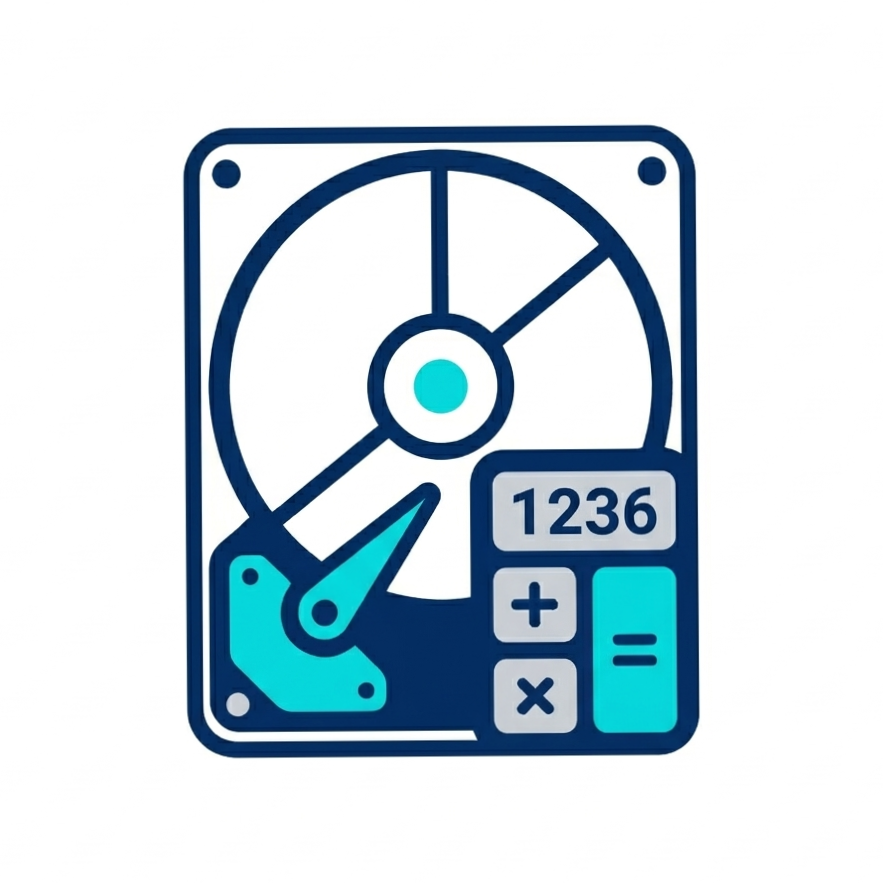

<div align="center">
  <a href="#readme" style="text-decoration:none; margin:0 10px; padding:8px 16px; background:#2563EB; color:white; border-radius:4px; font-weight:bold;">📖 Readme</a>
  <a href="./CHANGELOG.md" style="text-decoration:none; margin:0 10px; padding:8px 16px; color:#2563EB; border-radius:4px;">📜 Changelog</a>
  <a href="./APP_LOGIC.md" style="text-decoration:none; margin:0 10px; padding:8px 16px; color:#2563EB; border-radius:4px;">🧮 App Logic</a>
  <a href="./MIGRATION.md" style="text-decoration:none; margin:0 10px; padding:8px 16px; color:#2563EB; border-radius:4px;">🔁 Flutter → Kotlin</a>
</div>

<div align="center">

  

  # Disk Partition Calculator

  **Version 1.1.3 (build 14)**

</div>

[](https://kotlinlang.org)
[](https://developer.android.com/jetpack/compose)
[](https://m3.material.io)
[](https://developer.android.com)
[](CHANGELOG.md)
[](LICENSE)

A native Android app that calculates exact partition sizes for Windows. Enter the visible GB you
want after format, get the required MB to enter in the Windows disk setup dialog. Supports NTFS and
FAT32 with optional Windows Setup overhead simulation.

> **This repository is the Kotlin + Jetpack Compose rewrite of the original Flutter app.** The
> calculation logic, the copy and the persisted data format are unchanged — only the UI layer was
> rebuilt with Compose and a refreshed Material 3 design. See [MIGRATION.md](MIGRATION.md).

<details>
<summary>## Features</summary>

- **NTFS & FAT32** — Select filesystem type; each uses its own GB→MB conversion ratio
- **Windows Setup Simulation** — Adds the 566 MB System Reserved overhead for realistic partitioning
- **Quick Presets** — Tap 20 GB, 50 GB, 100 GB, 250 GB, 500 GB, or 1 TB for instant calculation
- **Split Partitions** — Divide a total disk capacity into 1-8 equal partitions with exact MB values
- **History Panel** — Every calculation is saved locally; browse or clear past results (capped at 100 entries)
- **Light & Dark Mode** — Full Material 3 theme with persistent preference, instant switching and a
  circular reveal animation that grows out of the point you tapped
- **In-App Updates** — Google Play native UI; flexible by default, mandatory after 5 days
- **Privacy Policy & About** — Built-in pages for transparency and app info
- **Offline & dependency-light** — No analytics, no network calls except Google Play in-app updates

</details>

<details>
<summary>## Screenshots</summary>

| Light | Dark |
|-------|------|
| *Screenshot coming soon* | *Screenshot coming soon* |

</details>

<details>
<summary>## Tech Stack</summary>

| Layer | Choice |
|-------|--------|
| Language | Kotlin 2.4 |
| UI | Jetpack Compose + Material 3 (Compose BOM 2025.09.01) |
| Architecture | Single-module MVVM: `ViewModel` + `StateFlow` UI state |
| Navigation | Compose state + `BackHandler` (three lightweight destinations) |
| Persistence | `SharedPreferences` behind a `KeyValueStore` seam |
| Serialization | Hand-rolled, unit-tested JSON codec (`core/json`) |
| Icons | Google Material Symbols compiled to vector drawables (`tools/generate_icons.py`) |
| Updates | Google Play In-App Updates (`com.google.android.play:app-update`) |
| Build | Gradle 9.6 + AGP 9.2.1 + Kotlin 2.4.0, R8 minification/shrinking |

</details>

<details>
<summary>## Getting Started</summary>

Requires **JDK 21** (Android Studio Ladybug or newer) and the Android SDK with API 36.

```bash
# Clone the repo
git clone https://github.com/Sajedur0/Disk-Partition-Calculator.git
cd Disk-Partition-Calculator

# Build a debug APK
./gradlew assembleDebug

# Install it on a connected device or emulator
./gradlew installDebug

# Run the unit tests
./gradlew testDebugUnitTest
```

### Build APK

```bash
./gradlew assembleRelease
```

### Build App Bundle (Play Store)

```bash
./gradlew bundleRelease
```

Release builds are signed with the debug key unless `app/keystore.properties` +
`app/release-key.keystore` are present, in which case those credentials are used.

</details>

<details>
<summary>## Project Structure</summary>

```
app/src/main/java/com/diskcalc/
├── DiskCalcApplication.kt              # Application entry point, owns AppContainer
├── MainActivity.kt                     # Single activity, edge-to-edge Compose host
├── core/
│   ├── calc/
│   │   ├── PartitionCalculator.kt      # Calc Tab logic (single partition)
│   │   ├── SplitPartitionCalculator.kt # Split Tab logic (multi partition)
│   │   ├── CalcInputValidator.kt       # Input validation + messages
│   │   ├── PartitionInputException.kt  # Split validation failure (original wording)
│   │   └── PartitionDiagnostics.kt     # Debug log of the partition math
│   ├── data/
│   │   ├── AppPreferences.kt           # Theme / filesystem / simulation settings
│   │   ├── HistoryStore.kt             # History persistence (max 100 entries)
│   │   ├── HistoryEntries.kt           # History payload builders for both tabs
│   │   ├── HistoryJsonCodec.kt         # JSON <-> ConversionHistory
│   │   └── KeyValueStore.kt            # Storage seam + SharedPreferences implementation
│   ├── json/                           # Minimal JSON parser/writer
│   ├── model/                          # FileSystemType, results, ConversionHistory, theme
│   ├── update/                         # Play in-app updates + app restart
│   └── util/                           # Share text and share/rate/link actions
├── di/AppContainer.kt                  # Manual dependency container
└── ui/
    ├── AppRoot.kt                      # Theme reveal, update checks, destinations
    ├── components/                     # SectionCard, toggles, chips, dialogs, history sheet
    ├── history/HistoryCardModel.kt     # History card presentation model
    ├── result/ResultContent.kt         # Result dialog copy (rows + explanations)
    ├── screens/                        # CalcTab, SplitTab, SettingsTab, About, Privacy
    ├── text/AppStrings.kt              # Every user-visible string
    ├── theme/                          # Colours, type, shapes, dimensions, reveal animation
    └── viewmodel/                      # Main / Calc / Split / History state holders

app/src/main/res/
├── drawable/ic_*.xml                   # Material Symbols vector icons
├── drawable*/                          # Splash background + app logo
├── mipmap-*/                           # Launcher icons (adaptive + legacy)
├── values/ styles, colours, strings
└── xml/network_security_config.xml

tools/
└── generate_icons.py                   # Regenerates the vector drawables from Material Symbols
```

</details>

<details>
<summary>## Tests</summary>

The unit tests live in `app/src/test/java/com/diskcalc/` and cover the logic that matters for
correctness — the same values the original project asserted:

- `PartitionCalculatorTest` — GB→MB conversion, 4 MB overhead, 566 MB Windows Setup overhead, FAT32 limit
- `SplitPartitionCalculatorTest` — fractional plans (476923 MB / 4), integer plans, validation errors
- `CalcInputValidatorTest` — empty / invalid / valid input handling
- `HistoryJsonCodecTest`, `HistoryStoreTest` — persistence, the 100 entry cap, corrupted payloads
- `AppPreferencesTest` — theme, filesystem and simulation persistence (ordinal compatibility)
- `HistoryEntriesTest`, `ResultContentTest`, `HistoryCardModelTest` — exact result/history copy
- `PartitionDiagnosticsTest`, `ShareTextTest`, `PartitionPresetsTest`, `JsonTest`, `ModelHelpersTest`

```bash
./gradlew testDebugUnitTest
```

</details>

<details>
<summary>## Version History</summary>

See [CHANGELOG.md](CHANGELOG.md) for full version history.

</details>

<details>
<summary>## License</summary>

```
MIT License

Copyright (c) 2024-2026

Permission is hereby granted, free of charge, to any person obtaining a copy
of this software and associated documentation files...
```

</details>
